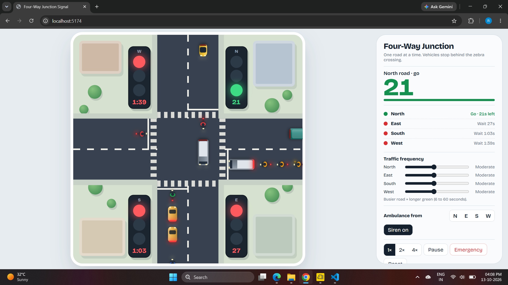
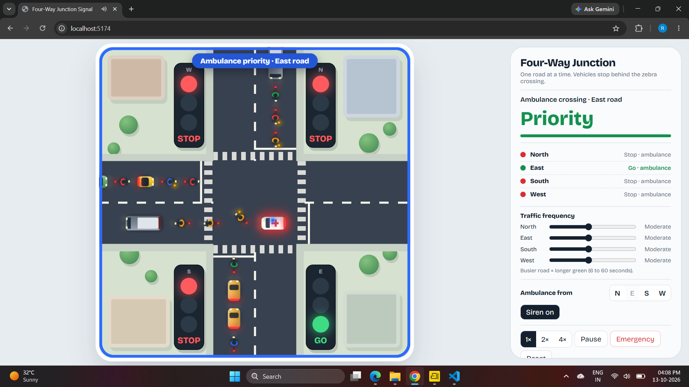
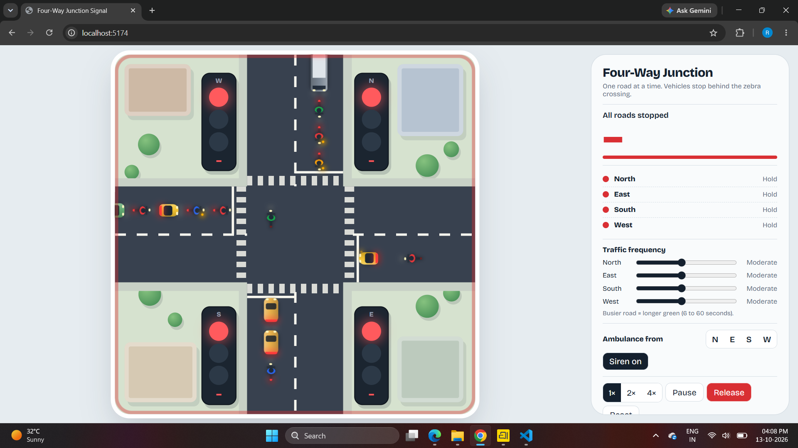

# Four-Way Junction Signal 🚦

A React and Vite-based four-way traffic junction simulation. It demonstrates how traffic lights coordinate vehicles from four directions and how the junction responds to traffic frequency and emergency vehicles.

## Screenshots

### 1. All roads stopped


### 2. North road green signal


### 3. Ambulance priority


## Features

- Four-way junction simulation: North, East, South, and West.
- Traffic lights with stop and go states.
- Vehicle movement through the junction.
- Traffic-frequency controls for each road.
- Ambulance selection by direction and siren control.
- Emergency priority mode to allow the selected ambulance route to pass.
- Simulation speed controls (1×, 2×, and 4×).
- Pause, release/emergency, and reset controls.

## Tech Stack

- React
- Vite
- JavaScript / JSX
- CSS

## Run Locally

1. Open a terminal in the project folder.
2. Install dependencies:

   ```bash
   npm install
   ```

3. Start the development server:

   ```bash
   npm run dev
   ```

4. Open the local URL printed by Vite in the terminal (for example, `http://localhost:5173`).

## Project Structure

```text
traffic-signal/
├── src/
│   ├── images/
│   │   ├── traffic1.png
│   │   ├── traffic2.png
│   │   └── traffic3.png
│   ├── App.jsx
│   ├── App.css
│   └── main.jsx
├── index.html
├── package.json
└── vite.config.js
```

## Screenshots in GitHub

Keep the screenshot files in `src/images/` with the exact filenames shown above. The image links in this README are relative to the repository root.

---
Built with React and Vite.
